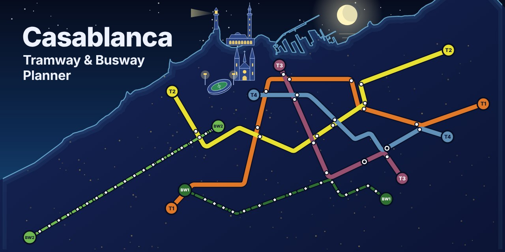

<p align="center">
  
</p>

<h1 align="center">Casablanca Tramway &amp; Busway Planner</h1>

<p align="center">
  An interactive route planner for the Casablanca tramway (T1 to T4) and busway (BW1 and BW2),<br>
  presented on a single page with the official network map.
</p>

<p align="center">
  <a href="https://mohamedaitabdelmalik.github.io/Casablanca-Tramway-and-Busway-Planner/"></a>
  <a href="https://github.com/mohamedaitabdelmalik/casablanca-tramway-busway"></a>
</p>

---

## About

Getting around Casablanca by tram or bus means knowing which line to take and where to change. This project puts the route planner and the network map side by side on one page, so you can look at the whole network and plan a trip without leaving the page.

The planner runs entirely in the browser. There is no server to install or wait for.

> **English** above, **français** below.

## Features

- **Route planning** between stops on the tramway and busway network.
- **Six lines** covered: tramway T1, T2, T3, T4 and busway BW1, BW2.
- **Interactive map** built on OpenStreetMap.
- **Official network map** on the page, with a click-to-enlarge view.
- **Planner shown in the same page**, with a full screen button.
- **Static site**: it works on GitHub Pages with no backend.
- **Responsive**: the page adapts to phones, tablets and desktops.

<!-- Add or remove features here to match what the planner really does. -->

## The network

| Line | Type    | Color on the official map |
|------|---------|---------------------------|
| T1   | Tramway | Orange                    |
| T2   | Tramway | Yellow                    |
| T3   | Tramway | Mauve                     |
| T4   | Tramway | Blue                      |
| BW1  | Busway  | Dark green                |
| BW2  | Busway  | Light green               |

## Built with

- HTML, CSS and JavaScript, with no framework
- [Leaflet](https://leafletjs.com/) for the interactive map
- [OpenStreetMap](https://www.openstreetmap.org/) for the base map data
- [GitHub Pages](https://pages.github.com/) for hosting

## Run it on your computer

You need a small local server, because browsers block some features when a page is opened as a plain file.

```bash
git clone https://github.com/mohamedaitabdelmalik/Casablanca-Tramway-and-Busway-Planner.git
cd Casablanca-Tramway-and-Busway-Planner
python -m http.server 8000
```

Then open <http://localhost:8000>.

## Project structure

```
.
├── index.html          # The page: header, planner, network map, footer
├── network-map.jpg     # Official network map shown on the page
├── assets/
│   ├── banner.svg      # README illustration
│   └── social-preview.png
├── .nojekyll           # Tells GitHub Pages to serve the files as they are
└── README.md
```

The planner itself lives in its own repository:
[`casablanca-tramway-busway`](https://github.com/mohamedaitabdelmalik/casablanca-tramway-busway).
This page shows it in a frame, so it always displays the latest published version.

## Deploy your own copy

1. Fork or clone this repository.
2. In **Settings → Pages**, choose **Deploy from a branch**, then `main` and `/ (root)`.
3. Wait about a minute, then open `https://<your-username>.github.io/<repository-name>/`.

## Français

**Planificateur d'itinéraire du tramway (T1 à T4) et du busway (BW1 et BW2) de Casablanca.**

Cette page réunit le calculateur d'itinéraire et le plan officiel du réseau. Le planificateur fonctionne entièrement dans le navigateur, sans serveur. Cliquez sur le plan pour l'agrandir, ou passez le planificateur en plein écran.

- **Démo en ligne** : <https://mohamedaitabdelmalik.github.io/Casablanca-Tramway-and-Busway-Planner/>
- **Code source du planificateur** : <https://github.com/mohamedaitabdelmalik/casablanca-tramway-busway>

## Credits and notice

- Map data © [OpenStreetMap](https://www.openstreetmap.org/copyright) contributors.
- The network plan shown on the page is the official Casa Tramway and Casa Busway plan (October 2025). It belongs to its publisher and is shown for reference only.
- This is an independent personal project. It is **not affiliated with** or endorsed by Casa Transports or the operators of the network. For official timetables and information, visit [casatramway.ma](https://casatramway.ma).

## Author

**Mohamed Ait Abdelmalik**, MSc Geoinformatics student at UH2C, working on GIS, remote sensing and web mapping.

[LinkedIn](https://www.linkedin.com/in/mohamed-ait-abdelmalik-a7b468195/) · [GitHub](https://github.com/mohamedaitabdelmalik) · [Email](mailto:mohamed.aitabdelmalik@gmail.com)

## License

All rights reserved unless a `LICENSE` file in this repository says otherwise.
